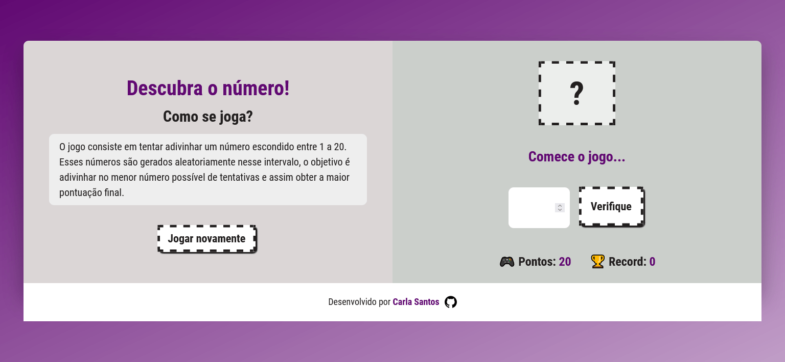
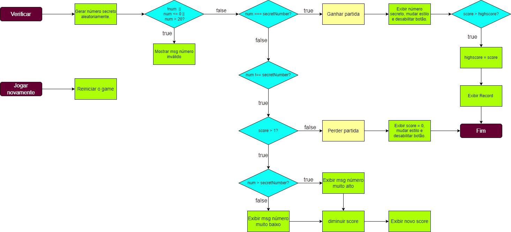

# :video_game: Descubra o número v2

[](https://github.com/carla-santos/descubra-numero-v2/graphs/contributors)
[](https://github.com/carla-santos/descubra-numero-v2/network/members)
[](https://github.com/carla-santos/descubra-numero-v2/issues)
[](https://github.com/carla-santos/descubra-numero-v2/blob/main/LICENSE)
[](https://github.com/carla-santos/descubra-numero-v2/pulls)

## Sumário

- [Sobre](#sobre-o-projeto)
   - [Tecnologias](#tecnologias)    
- [Como executar o projeto](#como-executar-o-projeto)
   - [Pré-requisitos](#pre-requisitos)
   - [Instalação](#instalacao)    
- [Fluxograma](#fluxograma) 
- [Contribuição](#contribuicao)
  - [Como contribuir para o projeto](#como-contribuir-para-o-projeto) 
- [Licença](#licenca)
- [Contato](#contato)
- [Agradecimento](#agradecimento)
- [Deploy](#deploy) 

## :green_book: Sobre o projeto <a name = "sobre-o-projeto"></a>

[](https://descubra-numero-v2.netlify.app/)

**Descubra o número** é um jogo de adivinhação cujo objetivo é acertar o menor número possível de tentativas. Possui um design estilo 'retro'. 

### Tecnologias <a name = "tecnologias"></a> :wrench:

Para essa segunda versão do jogo, foram utilizadas as seguintes tecnologias: 

- [HTML5](https://developer.mozilla.org/pt-BR/docs/Web/HTML)
- [CSS](https://developer.mozilla.org/pt-BR/docs/Web/CSS)
- [Tailwindcss](https://tailwindcss.com/)
- [JavaScript](https://developer.mozilla.org/pt-BR/docs/Web/JavaScript)
- [TypeScript](https://www.typescriptlang.org/)
- [NPM](https://www.npmjs.com/)
- [Vite](https://vite.dev/)

### Versões

Esta é a segunda versão, caso queira visitar a primeira versão, segue o repositório: [v1](https://github.com/carla-santos/descubra-numero-v1/tree/main)

---

## :computer: Como executar o projeto <a name = "como-executar-o-projeto"></a>

Para Iniciar o projeto, faça o clone desse repositório ou baixe de forma local em seu sistema. 
Você pode visualizar o jogo clicando no link [Descubra o número](https://descubra-numero-v2.netlify.app/).

### Pré-requisitos <a name = "pre-requisitos"></a>

Antes de começar, você precisa instalar, em sua máquina, as seguintes ferramentas: [Git](https://git-scm.com/), [Node.js](https://nodejs.org/en/) 
e um editor de código, como [VSCode](https://code.visualstudio.com/).

Siga as instruções abaixo para obter uma cópia local: 

### Instalação <a name = "instalacao"></a>

```bash

# Clone este repositório.
$ git clone https://github.com/carla-santos/descubra-numero-v2.git

# Acesse a pasta do projeto no seu terminal/cmd/(Git bash).
$ cd descubra-numero-v2

# Instale as dependências.
$ npm install

# Execute a aplicação.
$ npm run dev

```
Utilize uma ferramenta como o [Live Server](https://marketplace.visualstudio.com/items?itemName=ritwickdey.LiveServer) para criar um servidor local e executar o projeto.

---

## :chart: Fluxograma <a name = "fluxograma"></a>



O fluxograma foi criado para facilitar o desenvolvimento do jogo e entender os vários fluxos de processo de decisão. 
Utilizei a seguinte ferramenta [flowchart](https://app.diagrams.net/) para a criação desse diagrama de processo. 

### **Legenda**: 

- Início e Fim (roxo)
- Ação (verde)
- Decisão (azul)
- Ação importante (laranja)
 
--- 

## 👨‍💻 Contribuição <a name = "contribuicao"></a>

Primeiramente, agradeço a sua visita, qualquer contribuição que você fizer é muito bem-vindo :D.

### 💪 Como contribuir para o projeto <a name = "como-contribuir-para-o-projeto"></a>

1. Faça um **fork** do projeto.
2. Crie uma nova branch com as suas alterações: `git checkout -b meu-recurso`.
3. Salve as alterações e crie uma mensagem de commit contando o que você fez: `git commit -m "Recurso: meu novo recurso"`.
4. Envie as suas alterações: `git push -u origin meu-recurso`.

---

## :pencil: Licença <a name = "licenca"></a>  
 
O projeto está sob a licença MIT. Para saber mais, acesse o arquivo [LICENÇA]().

---

## :email: Contato <a name = "contato"></a>  

<a href="https://github.com/carla-santos">
 
 <br />
 <sub><b>Carla Santos 🎮</b></sub></a>

Desenvolvido com 🧡 por Carla Santos 👋🏽

Sinta-se à vontade para entrar em contato comigo :)

[](mailto:carla.devjs@gmail.com)

Meus outros links: [https://github.com/carla-santos](https://github.com/carla-santos)

---

## 🚀 Agradecimento <a name = "agradecimento"></a>  

- [Img Shields](https://shields.io)
- [Netlify](https://www.netlify.com/)
- [NPM](https://www.npmjs.com/)
- [Google Fonts](https://fonts.google.com/)
- [SASS guidelin](https://sass-guidelin.es/#architecture)
- [CSS-Tricks](https://css-tricks.com/introducing-sass-modules/)
- [Font Awesome](https://fontawesome.com)
- [Jonas Schmedtmann](https://www.udemy.com/user/jonasschmedtmann/)

---

## :dizzy: Deploy <a name = "deploy"></a>  

[]()
